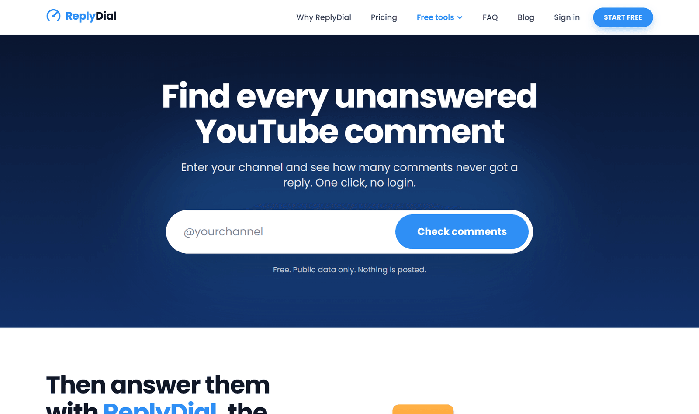
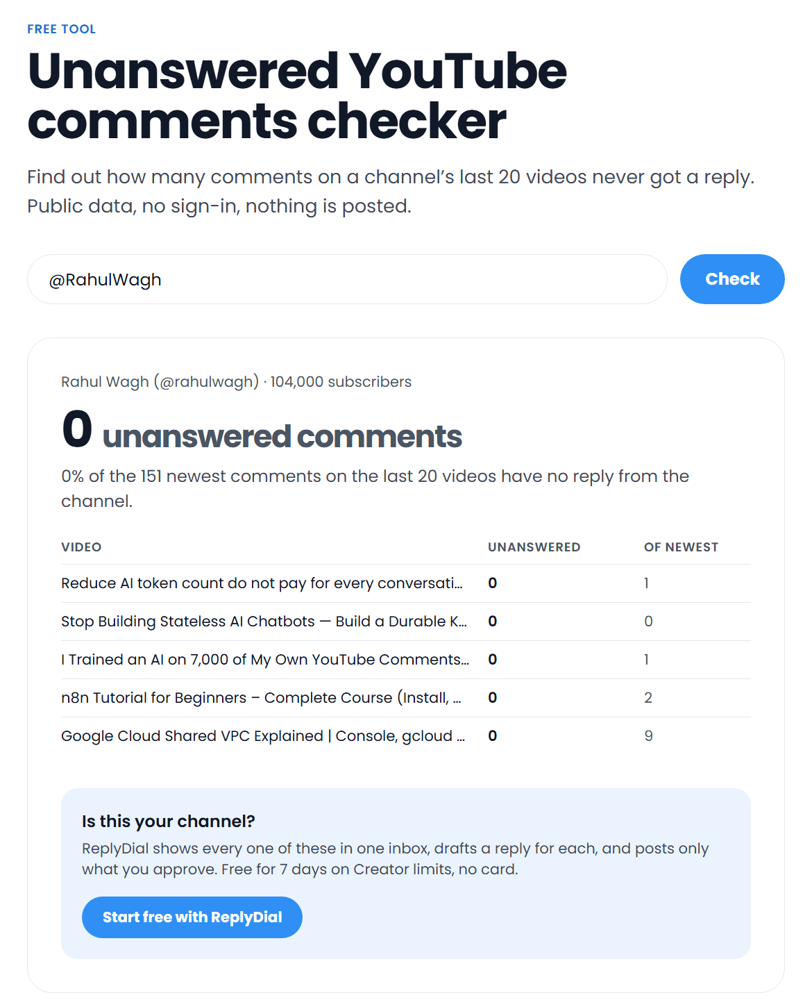
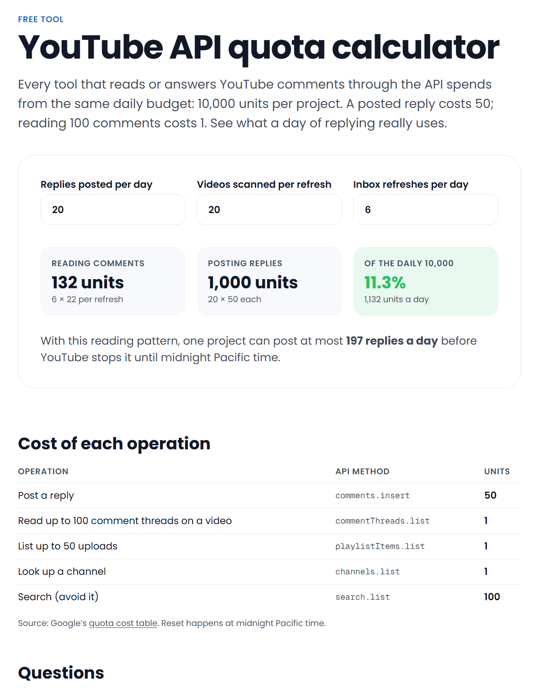
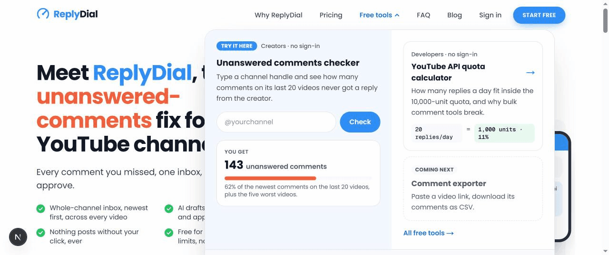

# YouTube Comment Tools

**Command-line tools and reference code for YouTube comments, built on the YouTube Data API v3.**
Find the comments a channel never answered, export a video's comments to CSV or JSON, and work out what the API quota allows. Read-only: an API key is all you need, and nothing is ever posted.

[](https://github.com/rahulwagh/youtube-comment-tools/actions/workflows/ci.yml)
[](LICENSE)


[](https://replydial.com)

These are the open building blocks behind [**ReplyDial**](https://replydial.com), a hosted tool that gives YouTube creators one inbox of every unanswered comment, drafts a reply for each in their voice, and posts only what they approve. Don't want to run anything? The same checks are free in the browser at [replydial.com/tools](https://replydial.com/tools), no sign-in.

[](https://replydial.com)

## Contents

- [The tools](#the-tools)
- [Quick start](#quick-start)
- [1. Unanswered comments](#1-unanswered-comments)
- [2. Export comments to CSV or JSON](#2-export-comments-to-csv-or-json)
- [3. API quota calculator](#3-api-quota-calculator)
- [Replying to the comments you find](#replying-to-the-comments-you-find)
- [Use it as a library](#use-it-as-a-library)
- [Guides for developers](#guides-for-developers)
- [The hosted version](#the-hosted-version)
- [FAQ](#faq)
- [Roadmap](#roadmap)

## The tools

| Command | What it does | Needs | Quota cost |
|---|---|---|---|
| [`yt-comments unanswered`](#1-unanswered-comments) | Counts and lists comments with no reply from the channel, across its recent videos | API key | about 22 units per channel |
| [`yt-comments export`](#2-export-comments-to-csv-or-json) | Exports every comment on a video (and its replies) to CSV or JSON | API key | 1 unit per 100 comments |
| [`yt-comments quota`](#3-api-quota-calculator) | Estimates the daily quota a reply workflow uses, and the most replies a project can post | nothing | none |

Zero dependencies. Node 20 or newer. Every tool is also a plain function you can import. None of them writes to YouTube.

## Quick start

```bash
git clone https://github.com/rahulwagh/youtube-comment-tools.git
cd youtube-comment-tools
export YOUTUBE_API_KEY=your_key      # PowerShell: $env:YOUTUBE_API_KEY = "your_key"
node bin/yt-comments.mjs unanswered @RahulWagh
```

Or without cloning:

```bash
npx github:rahulwagh/youtube-comment-tools unanswered @RahulWagh
```

No API key yet? It takes two minutes: [docs/getting-credentials.md](docs/getting-credentials.md). The key only reads public data; there is no sign-in and no access to your channel.

## 1. Unanswered comments

How many recent comments on a channel have no reply from the channel itself, and on which videos.

```bash
yt-comments unanswered @RahulWagh
```

```text
Rahul Wagh (@rahulwagh) · 104,000 subscribers
0 unanswered of 151 recent comments (0%) on the last 20 videos

Quota used: 22 units.
```

That is a real run on the author's own channel. On a channel with a backlog the output has this shape (example numbers):

```text
Example Channel (@example) · 82,000 subscribers
410 unanswered of 597 recent comments (69%) on the last 20 videos

    82  How to choose your first cloud certification
    74  A free roadmap for data engineers
    66  Five mistakes I made in my first DevOps job

Quota used: 22 units. Answer them with drafts you approve: https://replydial.com
```

| Option | Meaning |
|---|---|
| `--videos <n>` | How many recent videos to scan (default 20) |
| `--list` | Also print each unanswered comment with a direct link |
| `--deep` | Exact count: fetch all replies on long threads (1 extra unit per thread) |
| `--json` | Machine-readable output, including every unanswered comment |

**How it decides.** A comment thread is *unanswered* when none of its replies were written by the channel owner. Comments the owner wrote are skipped. The API returns at most five replies inline, so on a long thread where the owner answered late the default mode can over-count; `--deep` fetches the rest and is exact. Details in [src/unanswered.mjs](src/unanswered.mjs).

**Use cases**

- **A creator's weekly sweep:** see which videos have questions waiting before sitting down to answer.
- **Before hiring a community manager:** measure the backlog first.
- **Agencies and sponsors:** check how responsive a channel is to its audience from public data.
- **Your own dashboards:** `--json` into a cron job, track the number over time.

The same check runs in the browser, free and without sign-in: [replydial.com/tools/unanswered-checker](https://replydial.com/tools/unanswered-checker).

[](https://replydial.com/tools/unanswered-checker)

## 2. Export comments to CSV or JSON

Every comment on a video, newest first, with replies under the comment they belong to.

```bash
yt-comments export https://youtu.be/DQk8HOVlumI --replies all --out comments.csv
yt-comments export DQk8HOVlumI --format json > comments.json
```

```text
Exported 482 rows to comments.csv. Quota used: 4 units.
```

Columns: `comment_id, parent_id, type, author, author_channel_id, text, likes, reply_count, published_at, updated_at, url`

| Option | Meaning |
|---|---|
| `--format <csv\|json>` | Default `csv` (UTF-8 with BOM, opens cleanly in Excel and Google Sheets) |
| `--replies <none\|inline\|all>` | `inline` (default) includes up to five replies per thread at no extra cost; `all` fetches every reply |
| `--limit <n>` | Stop after n top-level comments |
| `--out <file>` | Write to a file instead of standard output |

**Safe for spreadsheets.** Cells that start with `=`, `+`, `-` or `@` are prefixed with `'`, so a comment like `=HYPERLINK(...)` is shown as text instead of being run as a formula ([CSV injection](https://owasp.org/www-community/attacks/CSV_Injection)). Handles start with `@`, so authors carry the prefix too; spreadsheets hide it.

**Use cases**

- **Find the questions:** filter the `text` column for `?` and sort by `likes`.
- **Plan the next video:** search the export for "can you make", "please cover", "next video".
- **Research and sentiment analysis:** feed the JSON to your own scripts or an LLM.
- **Archive:** keep a copy of the discussion before unlisting or deleting a video.

## 3. API quota calculator

Every Google Cloud project gets 10,000 YouTube API units a day. Reading 100 comments costs 1 unit; **posting one reply costs 50**. This shows what a workflow really uses.

```bash
yt-comments quota --replies 20 --videos 20 --refreshes 6
```

```text
Reading comments       132 units  (6 refreshes × 22)
Posting replies      1,000 units  (20 × 50)
Total per day        1,132 units  = 11.3% of 10,000

With this reading pattern one project can post at most 197 replies a day.
```

| Operation | API method | Units |
|---|---|---|
| Post a reply | `comments.insert` | 50 |
| Read up to 100 comment threads on a video | `commentThreads.list` | 1 |
| Read up to 100 replies of one thread | `comments.list` | 1 |
| List up to 50 uploads | `playlistItems.list` | 1 |
| Look up a channel | `channels.list` | 1 |
| Search (avoid it) | `search.list` | 100 |

Why this matters for anyone building on comments: a tool that posts for many users shares one quota across all of them, so "reply to everything" tools hit the wall at about 200 replies a day in total. More in [docs/quota.md](docs/quota.md). Interactive version: [replydial.com/tools/quota-calculator](https://replydial.com/tools/quota-calculator).

[](https://replydial.com/tools/quota-calculator)

## Replying to the comments you find

This toolkit stops at finding. It contains no code that posts, on purpose.

Posting a reply through the API looks like one call (`comments.insert`), but doing it properly for real users takes much more:

| What it takes | Why |
|---|---|
| OAuth with `youtube.force-ssl`, verified by Google | It is the only scope that can post; unverified apps are capped at 100 users and show a warning ([guide](docs/oauth-scope.md)) |
| A person approving every reply | Required by the API Developer Policies; unattended replies are what the spam policy targets ([guide](docs/policies.md)) |
| Pacing, daily and per-video caps, duplicate checks | So a channel never looks like a bot |
| A quota extension | One project can post about 200 replies a day in total ([guide](docs/quota.md)) |
| Encrypted token storage, disconnect, deletion | Limited Use and privacy obligations |

That is the product: [**ReplyDial**](https://replydial.com) lists every unanswered comment on your channel, drafts a reply for each in your voice, and posts the ones you approve with one tap each. Free for 7 days, no card.

If you are building your own app, the three guides linked in the table are the map.

## Use it as a library

Everything the CLI does is an importable function with no dependencies.

```js
import { createClient, checkUnanswered, exportComments, estimateQuota } from "youtube-comment-tools";

const yt = createClient({ apiKey: process.env.YOUTUBE_API_KEY });

const report = await checkUnanswered(yt, "@RahulWagh", { videos: 20 });
console.log(report.unanswered, "unanswered of", report.scanned);

for await (const row of exportComments(yt, "DQk8HOVlumI", { replies: "inline" })) {
  if (row.type === "comment" && row.text.includes("?")) console.log(row.author, row.text);
}

console.log(yt.units, "quota units used");
console.log(estimateQuota({ repliesPerDay: 40, refreshesPerDay: 10 }).percent, "% of the daily quota");
```

Install straight from GitHub: `npm install github:rahulwagh/youtube-comment-tools`

| Module | Exports |
|---|---|
| [`src/youtube.mjs`](src/youtube.mjs) | `createClient`, `getChannel`, `listUploads`, `parseChannel`, `parseVideo`, `COST`, `YouTubeError` |
| [`src/unanswered.mjs`](src/unanswered.mjs) | `checkUnanswered`, `classifyThread` |
| [`src/export.mjs`](src/export.mjs) | `exportComments`, `csvLine`, `csvCell`, `COLUMNS` |
| [`src/quota.mjs`](src/quota.mjs) | `estimateQuota` |

Run the tests with `npm test` (Node's built-in runner; the API is faked, no key needed).

## Guides for developers

Written from shipping an app on these APIs, including Google's OAuth verification.

| Guide | What it answers |
|---|---|
| [Getting an API key](docs/getting-credentials.md) | Two minutes in the Cloud Console; what a key can and cannot see |
| [Which OAuth scope posts a comment](docs/oauth-scope.md) | Why it is `youtube.force-ssl`, how to ask for it late, sensitive vs restricted, what verification checked |
| [Quota](docs/quota.md) | Unit costs, how to read cheaply, when you need the extension form |
| [Policies: what you may automate](docs/policies.md) | The Developer Policy clauses and the spam policy, applied to comment tools |
| [Use cases](docs/use-cases.md) | Recipes: weekly sweep, question mining, video ideas, dashboards |

Longer write-ups on the ReplyDial blog:

- [YouTube Data API: which OAuth scope do you need to post a comment](https://replydial.com/blog/youtube-api-oauth-scope-post-comments)
- [Automate YouTube comments: what is allowed, what gets channels in trouble](https://replydial.com/blog/automate-youtube-comments-what-is-allowed)
- [What YouTube Studio's comment tools can and cannot do](https://replydial.com/blog/youtube-studio-comment-tools)
- [How to find every unanswered comment on your YouTube channel](https://replydial.com/blog/find-unanswered-youtube-comments)
- [Best YouTube comment tools in 2026: an honest comparison](https://replydial.com/blog/best-youtube-comment-tools)

## The hosted version

This repository is the toolkit. [**ReplyDial**](https://replydial.com) is the product built on the same foundations, for creators who want the result rather than the code.

| | This repository | [ReplyDial](https://replydial.com) |
|---|---|---|
| Find unanswered comments | Last N videos, from the command line | Whole channel, one inbox, newest first, on your phone |
| Remember what you dismissed | No | Yes, across devices |
| Draft replies | No | AI drafts in your voice, per comment |
| Post replies | No (read-only) | One click per approved reply, paced and capped |
| Setup | Your own API key | Sign in with Google; access verified by Google |
| Price | Free, MIT | Free plan; paid plans from $12 a month, 7-day trial |

[](https://replydial.com/tools)

Start with the free checker, no sign-in: **[replydial.com](https://replydial.com)**

## FAQ

**Is this an official Google or YouTube project?**
No. It uses the public YouTube Data API v3 and follows the YouTube API Services Terms. YouTube is a trademark of Google LLC.

**Does the read-only part need access to my channel?**
No. `unanswered` and `export` use an API key and read the same public comments anyone can see on youtube.com.

**Can it reply to comments?**
No. The toolkit is read-only on purpose; see [Replying to the comments you find](#replying-to-the-comments-you-find). For a fast, human-approved reply workflow use [ReplyDial](https://replydial.com).

**Why does the count differ slightly from YouTube Studio?**
The default mode reads the newest 100 threads per video and up to five replies per thread. Use `--videos`, and `--deep` for exact answers on long threads. Held and spam comments are not visible to an API key.

**Can I get comments from private or members-only videos?**
Not with an API key. Those need the channel owner's sign-in, which this toolkit does not do.

**How do I avoid running out of quota?**
Read with `commentThreads.list` (1 unit per 100), never `search.list` (100 units), and cache. Run `yt-comments quota` for your numbers.

## Roadmap

- [ ] Publish to npm (`npx yt-comments`)
- [ ] `export` for a whole channel or playlist
- [ ] `unanswered --since <date>` for a weekly diff
- [ ] `questions`: list only comments that ask something
- [ ] Python port of the read-only tools

Ideas and bug reports are welcome in [issues](https://github.com/rahulwagh/youtube-comment-tools/issues). If this saved you an afternoon, a star helps other developers find it.

## Contributing, security, licence

- [CONTRIBUTING.md](CONTRIBUTING.md): how to run the tests and what kinds of changes fit
- [SECURITY.md](SECURITY.md): how to report a vulnerability
- [MIT License](LICENSE)

## Author

Built by [Rahul Wagh](https://www.youtube.com/@RahulWagh). I have run a DevOps channel on YouTube since 2020 (104k subscribers) and answered comments by hand for years before building [ReplyDial](https://replydial.com). More on the infrastructure side at [jhooq.com](https://jhooq.com).
